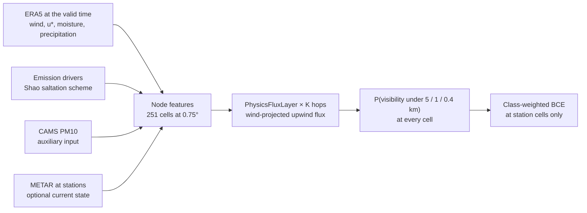

# PI-GNN-Dust

**Physics-informed graph neural networks for forecasting dust events over Saudi Arabia.**

[](https://github.com/Ziadt160/PI-GNN-Dust/actions/workflows/tests.yml)
[](LICENSE)


The model forecasts whether an airport will observe dust — visibility below 5 km,
1 km or 0.4 km — 3, 24 or 48 hours ahead. It runs on a graph of 251 cells covering
Saudi Arabia at 0.75°, where each message carries the wind-driven dust flux between
neighbouring cells. It is trained and scored on **observed** dust — 3.56 million
METAR airport reports — rather than on a reanalysis field.

**Where it stands.** At 24 h the flux-GNN reaches a threat score of **0.142** on
daily dust-storm days: 3.6× climatology and 1.45× gradient boosting, so the skill is
real and not trivially available. It is **not yet a warning system** — catching half
the storms costs about 90% false alarms.

## Key findings

1. **CAMS reanalysis misses dust storms by 15–49×.** Over 3,369 dust-coded storm
   hours, CAMS PM10 had a median of 268 µg/m³, while the observed visibility
   requires 3,912–13,040 µg/m³ (Koschmieder relation). In fog CAMS correctly stays
   clean (48 µg/m³), so the bias is specific to dust. This ended the project's
   original target.
2. **Skill measured against CAMS does not transfer to real storms.** Of eight models,
   the best against CAMS (TS 0.768) came second against observed storms; the
   baseline that ranked sixth against CAMS came first
   (`results/aidust_final.json`, `results/metar_validation.json`).
3. **42% of dust storms are imported.** Local friction velocity was below the
   emission threshold in 1,409 of 3,369 storm hours, and 68% of storms arrive on a
   northerly wind. An interior storm is preceded by a *northern* station's storm
   within 24 h 48.8% of the time, against 21.8% from the south.
4. **The model is mostly a wind forecast.** Permutation importance: future
   meteorology 40%, emission drivers 18%, CAMS PM10 5%, graph transport 3%
   (`results/feature_importance.json`).
5. **Physics works as architecture, not as a loss.** On the CAMS-target phase, adding
   an advection residual to the loss cut R² from 0.616 to 0.471 while giving the
   most realistic field structure; a complete emission–deposition residual cut it to
   0.127. The current models put the physics into the message passing and the
   features instead.

The evidence for each, and the silent bugs that would have invalidated them, is in
the [research log](docs/research_log.md).

## Results

24 h forecast of daily dust-storm days (visibility < 1 km), interior stations, test
years 2021–2024, 185 events:

| Model | TS | ETS | POD | FAR |
|---|---:|---:|---:|---:|
| never dust | 0.000 | 0.000 | 0.000 | — |
| climatology (station × month) | 0.039 | 0.033 | 0.092 | 0.937 |
| wind threshold | 0.072 | 0.067 | 0.135 | 0.865 |
| logistic regression | 0.072 | 0.067 | 0.135 | 0.865 |
| persistence | 0.076 | 0.070 | 0.141 | 0.859 |
| gradient boosting | 0.098 | 0.093 | 0.178 | 0.822 |
| **flux-GNN** | **0.142** | **0.137** | **0.249** | **0.751** |

Controls: `results/baselines_station.json`. Model: `results/station_daily_interior.json`,
row `24h|dust_storm|no-obs` (the station's own current reading withheld). On the
more common `dusty` grade (< 5 km, base rate 8.09%) the same model scores TS 0.267,
POD 0.421, FAR 0.579.

Reading these numbers:

- **ERA5 at the valid time stands in for a perfect wind forecast**, the same
  idealisation AI-DUST's evaluation makes. A version driven by an operational
  weather forecast would score lower.
- **TS falls with the event's base rate even when the forecast does not get worse.**
  At constant hit and false-alarm rates it drops 11.4× from the `dusty` grade to the
  `severe` grade while SEDI does not move (`tests/test_metrics.py`). Compare the rare
  `dust_storm` grade only with studies at a similar base rate.
- **There is no usable operating point yet.** Catching 50% of storms means a false
  alarm ratio of 0.90, about 18 false alarms per station per year
  (`results/operating_points.json`).

## How it works



- **Graph.** Each land cell is a node joined to its 8 neighbours, with positions in
  an `(east, north)` frame so wind projections carry the right sign.
- **Transport.** Each message from cell *j* to cell *i* is an MLP over both cells'
  features, the source wind projected onto the edge, and the upwind flux
  `(u_j · r_ji)(C_j − C_i)`. Downwind transport is built in, not learned.
- **Target.** One model per horizon, each fed meteorology at its own valid time. The
  whole graph runs forward; only cells with a station are supervised, so upwind
  cells without stations still act as sources.

The headline model uses two hops (a 152 km reach). Its successor,
`DustTransportGNN`, scales hops with the horizon to match how far dust travels
(7 hops, 532 km at 24 h) and adds a mass-conserving flux and per-cell deposition; it
is still being evaluated. Details: [docs/architecture.md](docs/architecture.md).

## Project history

| Phase | Target | Outcome | Code |
|---|---|---|---|
| 1. Gulf PM10 | CAMS PM10 on a 7 × 12 Gulf grid, 12 h ahead, 2003–2007 | R² 0.573 ± 0.006, +9.9% over persistence — but gradient boosting reached 0.642 on the same features | [`experiments/gulf_pm10`](experiments/gulf_pm10) |
| 2. Saudi PM10 | CAMS PM10 on 251 Saudi cells, 2003–2024; 29-model AI-DUST comparison | data-driven GNN R² 0.616 (persistence 0.332); validation against airports showed CAMS itself misses storms | [`experiments/saudi_pm10`](experiments/saudi_pm10) |
| 3. Station dust | observed airport visibility, 3–48 h ahead | current work, results above | [`experiments/station_dust`](experiments/station_dust) |

A 1 km Riyadh track ([`experiments/riyadh_1km`](experiments/riyadh_1km)) has a
forecast model validated on synthetic data and a dataset skeleton; its data loaders
are not written yet.

## Repository layout

```
├── src/                     library code
│   ├── layers/flux.py       PhysicsFluxLayer, ConservativeFluxLayer
│   ├── models/              dust_transport.py (current), pi_gnn.py (phase 1),
│   │                        ordinal.py, and the AI-DUST comparison models
│   ├── physics/             emission, transport, stability, physics losses
│   ├── data/                Saudi fields, METAR dust labels, feature assembly
│   ├── metrics/             TS/ETS/SEDI scores, published reference values
│   └── paths.py             where the large datasets live (DUST_DATA_ROOT)
├── experiments/
│   ├── data_prep/           downloaders and dataset builders
│   ├── gulf_pm10/           phase 1
│   ├── saudi_pm10/          phase 2, including validation against METAR
│   ├── station_dust/        phase 3: training, controls, importance, job queue
│   └── riyadh_1km/          1 km downscaling track
├── tests/                   physics, metric and checkpoint audits (pytest)
├── configs/                 phase 1 configuration
├── data/                    the small 2003–2007 Gulf sample (committed)
├── results/                 cited result files and checkpoints — see results/README.md
├── notebooks/               data exploration
└── docs/                    architecture, research log, supervisor report
```

## Getting started

Requires Python 3.10. Versions are pinned to the environment that produced the
results; for a CUDA build of torch, follow the comment in `requirements.txt`.

```bash
pip install -r requirements-dev.txt
python experiments/verify_env.py
pytest
```

The tests are synthetic and need no data. Phase 1 runs on the committed Gulf sample:

```bash
python experiments/gulf_pm10/train_model.py
python experiments/gulf_pm10/benchmark.py
```

### Data for phases 2 and 3

The Saudi datasets total about 17 GB and are not in the repository. Scripts look
for them under `DUST_DATA_ROOT`, which defaults to `data/`:

```bash
export DUST_DATA_ROOT=/path/to/data      # PowerShell: $env:DUST_DATA_ROOT = "..."
```

| Data | Source | Script |
|---|---|---|
| CAMS EAC4 PM10/PM2.5 and ERA5 surface fields, 2003–2024 | Copernicus ADS / CDS | raw files merged by `data_prep/build_saudi_dataset.py`; `data_prep/download_wide_domain.py` fetches the same products for a wider domain |
| ERA5 emission drivers and pressure levels | Copernicus CDS | `data_prep/download_era5_emission.py`, `data_prep/download_era5_levels.py` |
| METAR visibility and present weather | Iowa Environmental Mesonet (no account needed) | `data_prep/download_metar_saudi.py` |
| MODIS MAIAC aerosol optical depth | NASA Earthdata | `data_prep/download_maiac.py`, then `data_prep/build_erodibility_map.py` |

The Copernicus downloads need an API key in `~/.cdsapirc`; MAIAC needs an Earthdata
token in `~/.edl_token`. Then, for example:

```bash
python -u experiments/station_dust/train_station_dust.py --epochs 25 --interior-only --daily --obs-input
python -u experiments/station_dust/baselines_station.py
```

## Citing the data

ERA5 and CAMS data are generated using Copernicus Climate Change Service and
Copernicus Atmosphere Monitoring Service information. METAR observations come from
the Iowa Environmental Mesonet ASOS archive, and MAIAC AOD (MCD19A2) from NASA's
LP DAAC.

## License

[MIT](LICENSE)
