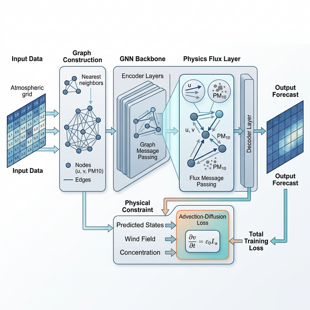
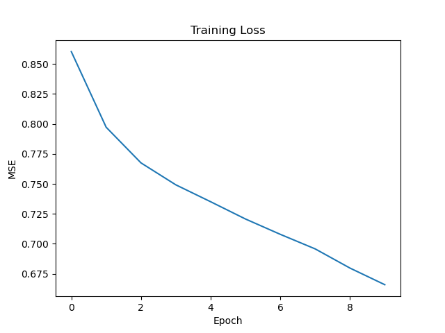
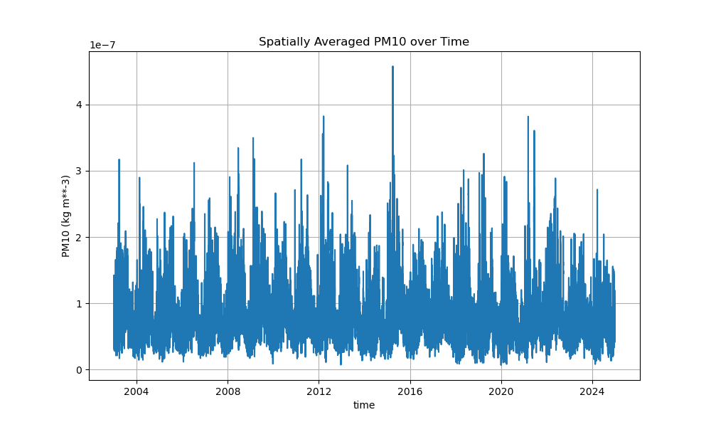

# Physics-Informed Graph Neural Network (PI-GNN) for Atmospheric Dust Forecasting


*Physics-Informed Graph Neural Network (PI-GNN) architecture for atmospheric dust transport.*

## Project Overview
This repository implements a Physics-Informed Graph Neural Network that forecasts
PM10 dust concentration over a small lat/lon grid in the Arabian Gulf region. The
grid is treated as a mesh of interacting control volumes, and transport is
regularised toward the **advection equation** `dC/dt + u·∇C = 0`.

On a strictly held-out test year, the model achieves **R² ≈ 0.57** and reduces error
by **~10% over a strong persistence baseline** — a genuine, seed-stable improvement
(the baseline persistence model already explains ~53% of variance, so this is real
forecast skill, not autocorrelation). All numbers below are produced by the scripts
in this repo and reported honestly.

> **Note on prior results.** Earlier versions of this README reported metrics
> (e.g. persistence MSE 1.22, model MSE 0.74 / R² 0.26) that were inconsistent with
> the data — a model MSE above the target variance (0.68) cannot have a positive R².
> Those numbers were never produced by this pipeline and have been replaced by the
> measured values below.

---

## Model

### Architecture
- **Graph construction** — each grid cell is a node connected to its 8 neighbours
  (N/S/E/W + diagonals, so winds at ~45° are representable in one hop). Node
  positions use a geographically-oriented frame (`+east`, `+north`) so wind
  projections carry the correct sign.
- **PhysicsFluxLayer (×2 hops)** — message passing where each message combines the
  (standardised) node features with an explicit **upwind advection term**
  `(u·n̂_{j→i})·(C_j − C_i)` from the *physical* source-cell wind and the
  concentration gradient along the edge. Two stacked layers (with residual
  connections) widen the spatial receptive field.
- **Residual head** — predicts `Δ(log PM10)`; the next state is `C_{t+1} = C_t + Δ`.
  The head is zero-initialised, so training starts from persistence and learns
  corrections. (No `Softplus`: the `log1p` target is already ≥0, and a Softplus
  would impose a spurious ln(2)≈0.69 floor on low concentrations.)
- **Inputs** — node features carry the current frame `[log_pm10, u10, v10, t2m]`,
  a **temporal history window** (previous frames, so the model perceives the
  tendency `dC/dt`), the **10 m wind speed**, and a **day-of-year (sin/cos)** season
  encoding. All features are standardised using statistics **fitted on the training
  split only** (stored as model buffers) — no leakage across splits.

### Physics-informed loss
Two terms balanced by **homoscedastic uncertainty weighting** (Kendall et al., 2018):
1. **Data loss** — `MSE(Ĉ_{t+1}, C_{t+1})` in log space.
2. **Physics residual** — discretised advection residual
   `‖(C_{t+1} − C_t) + (u·∇C_t)·Δt‖²`, using correct grid spacing
   (`dy ≈ 83.5 km`, `dx ≈ 74.9 km` at 26°N) and the correct latitude orientation
   (latitude decreases with row index, so the row-axis derivative is negated).

Mass conservation is **not** a training penalty (an open domain exchanges mass via
boundary flux) but is reported as a diagnostic.

---

## Results

**Evaluation protocol — strict 3-way temporal split, no leakage:**

| Split | Years | Role |
| :--- | :--- | :--- |
| Train | 2003–2005 | parameter fitting + normalisation statistics |
| Validation | 2006 | model selection / checkpointing (on MSE) |
| **Test** | **2007** | held-out final evaluation (never used for selection) |

**Held-out test (2007), 12 h forecast, log-space:**

| Metric | Persistence Baseline | **PI-GNN** |
| :--- | :---: | :---: |
| MSE | 0.3205 | **0.2842** |
| RMSE | 0.5661 | **0.5331** |
| MAE | 0.4175 | **0.3961** |
| R² | 0.5265 | **0.5802** |

- **Skill vs persistence:** +11.3% MSE for the shipped checkpoint; **+9.9% ± 1.2%**
  averaged over 3 seeds (R² 0.573 ± 0.006) — i.e. the gain is well outside seed noise.
- **Wind sensitivity:** flipping the wind field changes the predicted increment
  (corr ≈ −0.49), confirming the model uses the meteorology.
- **Mass-conservation diagnostic:** ≈ 0.6% (log) / ≈ 4.3% (physical) domain-mean error.
- **Autoregressive rollout** (6 steps / 72 h, true forcing): stable, no blow-up.
- **Inference latency:** ≈ 1 ms per forecast step (CPU).

### What drives the performance (ablation, test 2007, 3 seeds)

| Configuration | Test R² | Skill vs persistence |
| :--- | :---: | :---: |
| Baseline (single frame, 1-hop, 4-neighbour) | 0.530 | +0.5% *(within noise)* |
| **+ history window, wind speed, season, 2-hop, 8-neighbour** | **0.573** | **+9.9%** |
| ↳ same model at **6-hourly** resolution | **0.713** | **+20.6%** |

Reproduce with `python experiments/gulf_pm10/ablation.py`. The dominant levers are giving the
model **temporal context** (so it learns the tendency rather than copying the last
frame) and, if a shorter horizon is acceptable, **finer temporal resolution** (the
advection physics is only numerically valid when the CFL number is ≲ 1, which holds
at 6 h but not 12 h).

### Validation against classical baselines (test 2007, same features)

To check whether the graph + physics machinery is justified, every method is
evaluated on the identical test set, target, and node features
(`python experiments/gulf_pm10/classical_baselines.py`):

| Method | MSE | R² | Skill vs persistence |
| :--- | :---: | :---: | :---: |
| Gradient Boosting (no graph) | **0.2421** | **0.642** | **+24.4%** |
| Random Forest (no graph) | 0.2425 | 0.642 | +24.3% |
| Ridge linear (no graph) | 0.2613 | 0.614 | +18.5% |
| **PI-GNN (graph + physics)** | 0.2842 | 0.580 | +11.3% |
| Persistence | 0.3205 | 0.527 | 0.0% |
| Climatology (monthly) | 0.3648 | 0.461 | −13.8% |
| Persistence-of-tendency | 0.7987 | −0.18 | −149% |

**Honest interpretation.** The PI-GNN is *learning* — it clearly beats persistence,
climatology, and naive tendency. **But it does not beat classical tabular models** on
this task: gradient boosting, random forest, and even plain linear regression score
higher using the same features with no graph and no physics. Because the GNN has
strictly more information (edges + advection prior) yet underperforms, the signal here
is predominantly **local/per-cell** at a 12 h horizon, and the physics residual likely
regularises the model away from the best data fit. For this problem as framed, a
**gradient-boosted tree is the stronger and simpler model**; the PI-GNN's value is in
physical interpretability (wind-projected flux) rather than raw accuracy.

### Visual Results
| Training Convergence | PM10 Time Series |
| :---: | :---: |
|  |  |
| *Weighted train/val loss and validation MSE over epochs.* | *12-hour PM10 trajectory capturing episodic dust events.* |

---

## How to improve further
Ordered by expected impact (see commit history / ablation for what is already done):
1. **Use all available years.** The CAMS target spans 2003–2024, but only 2003–2007
   ERA5 is present — training on 3 years. Downloading ERA5 2008–2024 (the download
   script is already configured for it) gives ~6× the data and many more dust events.
2. **Add dust-emission predictors** to the CDS request: 10 m wind gust, volumetric
   soil moisture, boundary-layer height, total precipitation, MSLP, and (from CAMS)
   dust AOD / emission flux.
3. **Forecast at 6 h** instead of 12 h if the use case allows (R² 0.53 → 0.71 here).

---

## Dataset
- **Source:** ERA5 reanalysis (meteorology) + CAMS reanalysis (PM10 target).
- **Region / grid:** 7 × 12 cells at 0.75° (≈24–28.5°N, 47–55.25°E).
- **Temporal resolution:** raw data is 3-hourly; resampled to the configured cadence
  (default 12 h mean).
- **Target preprocessing:** PM10 scaled kg/m³ → µg/m³ (×1e9) then `log1p`
  (target mean ≈ 4.07, variance ≈ 0.68 in log space).
- **Variables:** PM10 (target), `u10`/`v10`, `t2m`; engineered features add temporal
  history, wind speed, and day-of-year seasonality.

### Data Acquisition (ECMWF / CDS API)
1. Configure a CDS API key.
2. `python experiments/data_prep/download_full_data.py` — primary dataset.
3. `python experiments/data_prep/download_chunked.py` — resilient monthly-partitioned download.
4. `python experiments/verify_env.py` — validate dependencies and data presence.

---

## Reproducibility

Run everything from the repository root.

```bash
pip install -r requirements.txt
python experiments/verify_env.py     # check env + data
python experiments/gulf_pm10/train_model.py    # train (3-way split, seeded)
python experiments/gulf_pm10/benchmark.py       # evaluate on held-out 2007 test set
python experiments/gulf_pm10/ablation.py        # reproduce the configuration comparison
```

Configuration (paths, split years, model size, features, physics constants) lives in
`configs/default_config.yaml`; paths resolve relative to the repo root. A fixed seed
makes runs reproducible. Artifacts: `results/best_pi_gnn.pth` (checkpoint),
`results/feature_stats.json` (train-fit normalisation), `results/benchmark_summary.json`.

---

## Repository Structure

```
repo/
├── README.md                 # This document
├── requirements.txt          # Dependencies
├── configs/default_config.yaml
├── src/                      # Core PI-GNN library
│    ├── models/pi_gnn.py     # PIDustModel (multi-hop, residual head, norm buffers)
│    ├── layers/flux.py       # PhysicsFluxLayer (wind-projected message passing)
│    ├── physics/loss.py      # Advection residual + mass-conservation diagnostic
│    ├── training/dataset.py  # GraphDustDataset (history/features) + train-only stats
│    ├── training/trainer.py  # Homoscedastic-weighted training loop
│    └── utils/graph.py       # Grid → graph (4/8-neighbour, geo-oriented positions)
├── experiments/
│    ├── train_model.py       # Training entry point (3-way split, seeded)
│    ├── benchmark.py         # Held-out evaluation suite
│    ├── ablation.py          # Configuration comparison (baseline vs enhanced vs 6 h)
│    ├── debug_loss.py        # Physics-residual inspection utility
│    ├── verify_env.py        # Environment + data validator
│    └── download_*.py        # CDS/ERA5 data acquisition
├── notebooks/                # Data exploration
├── results/                  # Checkpoint, stats, figures, benchmark summary
└── diagrams/architecture.md  # Detailed architecture / equations
```
